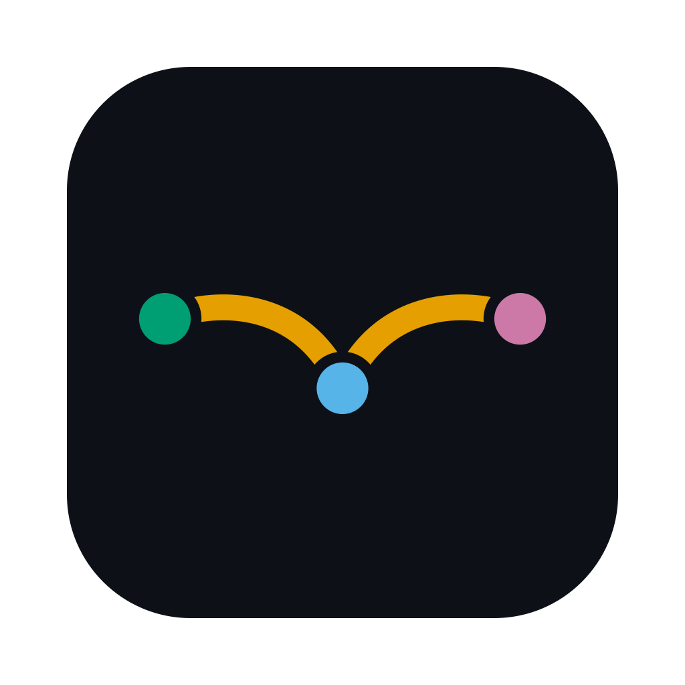

<p align="center">
  
</p>

<h1 align="center">Flights</h1>

<p align="center">Find the shortest route between two airports, one hop at a time.</p>

Flights is the airport-code route puzzle from [`jotto-cli`](https://github.com/guslipkin/jotto-cli), created by [Gus Lipkin](https://guslipkin.me), rebuilt in Flutter for:

- **Android** (`me.guslipkin.flights`)
- **iPhone and iPad** (one universal app)
- **macOS** (Apple Silicon)

## Playing

Each game deals a start and a destination airport whose codes differ in every letter. Each hop changes **one letter** of your current airport's code (LAX → LAS → LOS), and needs a real ticket between the two: a direct flight or one with a connection. The options list shows every airport you can hop to. Win by arriving by the shortest distance; arrive the long way and you're told so, and can go back and improve. `← Go Back` undoes hops, and when the game ends (by arriving or giving up) the route panel shows where your route left the shortest one and lets you step through each hop on the map.

**Touch:** tap an option (or an orange airport on the map) to preview its hop, then tap it again or press `Fly →`. Settings → **Tap to fly** → *One tap* flies on the first tap instead.

**Mouse and trackpad:** a click flies straight away, as in `jotto-cli`. The scroll wheel zooms and dragging pans the map.

**Keyboard** (matching the `jotto-cli` TUI; Help lists the keys on macOS, or once a key has been pressed):

| Key | Action |
|---|---|
| `↑` / `↓` | Select an option (or a hop once the game is over) |
| `→` / `Enter` | Fly |
| `←` / `Backspace` | Go back |
| `PgUp` / `PgDn` | Scroll the route |
| `+` / `-` | Zoom the map |
| `W` `A` `S` `D` | Pan the map |
| `0` | Fit the map |
| `Esc` | Leave the full-screen map |
| `?` | Help |
| `Ctrl`/`⌘` + `N` / `T` / `D` / `G` / `U` / `S` | New game / daily / next difficulty / give up / units / settings |

### Difficulty

| Level | Hop limit | Shown |
|---|---|---|
| Easy | 4 | Map, distances and connections |
| Medium | 6 | Map and connections |
| Hard | 8 | Connections only |
| Pilot | None | Codes only |
| Custom | Your choice | Your choice |

### Daily challenge

The daily puzzle is the same for everyone each UTC day, and the same one `flights --daily` deals on the CLI: the app ports `fastrand` 2.5.0's random number generator so both pick identical puzzles.

## Features

- **Offline map:** Natural Earth coastlines at three levels of detail, with pinch, scroll and double-tap zoom, panning, full screen, and `Fit` framing that works across the antimeridian. Hops are drawn as great-circle arcs or straight lines in the colorblind-safe Okabe-Ito palette, with labels that avoid overlapping.
- **Layout:** whenever the window is wider than tall (and at least 760pt wide), the map sits beside a side column that takes a third of the width, between 300 and 440pt. Otherwise the map stacks above the options, whose box has a fixed height (at most 380pt) so it doesn't jump between hops. Either way, the map gets all the remaining space and keeps its zoom when the window is resized. Phones are locked to portrait; iPads rotate and Mac windows resize down to 380pt wide.
- **Themes:** Light, Dark or System (follows the device). Dark comes in Navy or Black (for OLED screens). The light theme uses darker accents so colored text stays readable on white.
- **Sound and haptics:** short jet flyby sounds and haptic pulses for hops, going back, long flights and winning. Either can be turned off in Settings.
- **Autosave:** the game in progress is saved after every move and picked up where you left it on the next launch. Settings (units, map lines, theme, sound, haptics, tap to fly and custom rules) and the difficulty you last chose are kept between games. As in the CLI, a finished game isn't kept: the next launch deals a new one at your difficulty. Playing the daily (always Medium) doesn't change it.
- **Update check:** on launch, the app asks GitHub for the latest release, and if it's newer than the running version, shows a one-line banner linking to it (dismiss it with ✕). It sends nothing about you or your game, and if GitHub can't be reached (offline, rate-limited, down) it stays silent. It's the app's only network use.

## Development

```bash
flutter test                                # engine, daily parity, coastlines, keyboard, layout, themes
flutter build apk --release                 # Android
flutter build ios --release --no-codesign   # iPhone and iPad
flutter build macos --release               # macOS
```

The builds land in `build/app/outputs/flutter-apk/app-release.apk`, `build/ios/iphoneos/Runner.app` and `build/macos/Build/Products/Release/Flights.app`. To install on an iPhone or iPad, open `ios/Runner.xcworkspace` in Xcode and run it from there with your team selected.

### Data

`assets/flights.tsv` and `assets/coastlines.bin` come from `jotto-cli`. To refresh them from `../jotto-cli/data`:

```bash
./scripts/sync-data.sh
```

### App icon

The icon has one source, `assets/icon/flights_icon.svg`. After editing it, regenerate every platform's icons on a Mac and commit the results:

```bash
./scripts/render-icons.sh
```

The script renders the SVG with AppKit (`scripts/svg2png.swift`, which keeps transparency) into three PNGs in `assets/icon/`: a full square for iOS and older Android, a transparent foreground that fits inside Android's adaptive-icon masks, and a rounded tile on Apple's icon grid for macOS. It then runs [`flutter_launcher_icons`](https://pub.dev/packages/flutter_launcher_icons) (configured in `pubspec.yaml`) to write each platform's icon set.

### CI and releases

- **CI** (`.github/workflows/ci.yml`) runs `flutter analyze` and `flutter test` on every push to `main` and every pull request.
- **Release** (`.github/workflows/release.yml`) runs when a version tag such as `v1.2.3` is pushed. It runs the tests, then builds and attaches these to the tag's GitHub release:
  - `Flights-android.apk`, signed with the release key (see [Android signing](#android-signing)), so each release installs as an update over the last.
  - `Flights-macos-arm64.zip`, unsigned: on first open, right-click → Open, or allow it in System Settings → Privacy & Security.

If the release doesn't exist yet it's created with generated notes; one written by hand beforehand is kept. The app version comes from the tag and the build number from the workflow run number (`scripts/ci-build-args.sh`). Running the workflow by hand from the Actions tab produces the same builds as downloadable artifacts, without a release.

There's no iOS build in releases: an unsigned `.ipa` can't be installed, and signing one needs a paid Apple developer account. To put the app on an iPhone or iPad, build it locally as above. The macOS build uses a macOS runner, which bills at 10× the minutes on a private repo, so it only runs on tags or by hand. Notarized macOS and TestFlight builds would need Apple signing keys added as repository secrets.

### Android signing

Android only installs an update if it's signed with the same key as the app already installed, so every release must be signed with one permanent key. Without it each build is signed with a debug key unique to the machine (and to each CI run), and installing a newer release fails with a signing certificate mismatch.

The key is a keystore file kept outside the repository. **Keep it and its password backed up**: if it's lost, no later release can update installed copies, and everyone has to uninstall (losing their saved game) and reinstall.

The release workflow reads it from four repository secrets, and fails rather than fall back to a debug key if they're missing:

| Secret | Value |
|---|---|
| `ANDROID_KEYSTORE_BASE64` | The keystore file, base64-encoded (`base64 -i flights-release.jks`) |
| `ANDROID_KEYSTORE_PASSWORD` | The keystore's password |
| `ANDROID_KEY_ALIAS` | The key's alias in it |
| `ANDROID_KEY_PASSWORD` | The key's password |

The release log's "Show the signing certificate" step prints the key's fingerprint, which should be the same on every release.

To sign local release builds with the same key, so they also install over a release, create `android/key.properties` (git-ignored):

```properties
storeFile=/path/to/flights-release.jks
storePassword=...
keyAlias=...
keyPassword=...
```

Without it, a local `flutter build apk --release` uses your machine's debug key: fine for trying a build, but it has to be uninstalled before a release will install, and vice versa.

## Credits and license

- **Flights** is an original game created by [Gus Lipkin](https://guslipkin.me).
- Routes from the "Airlines and destinations" sections of [English Wikipedia](https://en.wikipedia.org/) airport articles, under [CC BY-SA 4.0](https://creativecommons.org/licenses/by-sa/4.0/).
- Airport codes and coordinates from [OurAirports](https://ourairports.com/data/) (public domain).
- Map coastlines from [Natural Earth](https://www.naturalearthdata.com/) (public domain).
- Jet sounds from [Wikimedia Commons](https://commons.wikimedia.org/): *Jet airliner overhead* and *Airplane Boeing Flyby* by InspectorJ, under [CC BY 4.0](https://creativecommons.org/licenses/by/4.0/).
